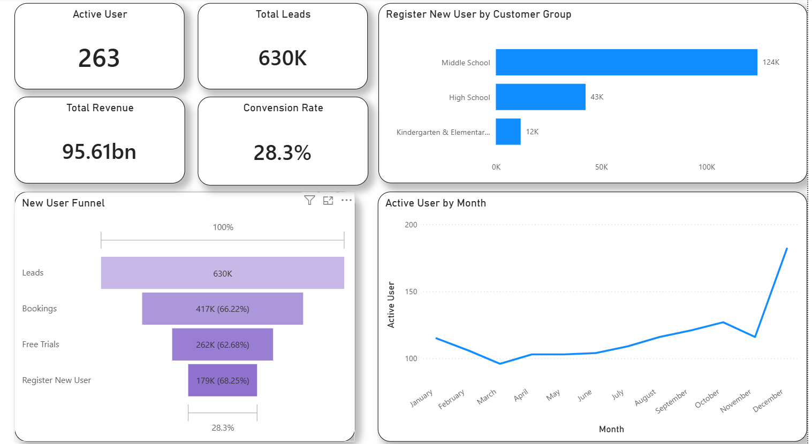
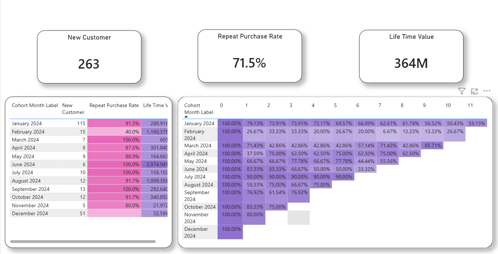

# Funnel and Cohort Analysis

How well does the business acquire new users, and how well does it keep them? This project combines a **conversion funnel** (acquisition, education startup data) with a **monthly cohort analysis** (retention, fintech transaction data), and shows why neither view is enough on its own. Built in Power BI as part of a Data Analyst bootcamp.




## Business Questions

1. Where do potential users drop off before they become customers?
2. Do users stay and keep buying after they join, and does that differ by cohort?
3. Why should funnel and cohort metrics be tracked together?

## Datasets

| Dataset | Used for | Detail |
|---|---|---|
| Education startup funnel (`data/funnel_education_startup.xlsx`) | Funnel | 12 rows: 4 stages (Leads, Bookings, Free Trials, Register New User) x 3 customer groups (Kindergarten & Elementary School, Middle School, High School) |
| Fintech transactions (`data/cohort_fintech.xlsx`) | Cohort, active users, revenue | 22,466 rows (date, username, revenue), 263 unique users, 2024-01-01 to 2024-12-31, total revenue 95.61bn, no missing values |

## Part 1: Funnel (Acquisition)

| Stage | Users | Conversion from previous stage |
|---|---|---|
| Leads | 630K | |
| Bookings | 417K | 66.22% |
| Free Trials | 262K | 62.68% |
| Register New User | 179K | 68.25% |
| **Overall** | | **28.3%** |

Other KPIs on the dashboard (from the fintech dataset): 263 active users, total revenue 95.61bn.

Registered users by customer group: Middle School 124K, High School 43K, Kindergarten & Elementary 12K.

Active users by month stay between about 96 and 127 from January to November, then jump to about 182 in December.

**Key finding:** Of 630,338 leads, only 417,400 reach Bookings. The 212,938 users lost (33.8%) are the largest drop-off in absolute numbers in the whole funnel.

**Likely causes (hypotheses, not yet tested):** pricing seen as not competitive, and booking-page information that is not convincing enough.

**Recommendation:** benchmark prices against competitors or offer an early-stage discount, and improve the copywriting and information on the booking page.

## Part 2: Cohort (Retention)

| KPI | Value |
|---|---|
| New customers | 263 |
| Repeat purchase rate | 71.5% |
| Lifetime value | 364M |

| Cohort | New customers | Repeat purchase rate | Lifetime value |
|---|---|---|---|
| January 2024 | 115 | 91.3% | 288,916,953 |
| February 2024 | 15 | 40.0% | 1,160,378,933 |
| March 2024 | 7 | 100.0% | 605,215 |
| April 2024 | 8 | 87.5% | 301,840,740 |
| May 2024 | 9 | 88.9% | 164,663,222 |
| June 2024 | 6 | 100.0% | 2,974,941,932 |
| July 2024 | 10 | 100.0% | 158,102,103 |
| August 2024 | 12 | 91.7% | 1,009,356,231 |
| September 2024 | 13 | 100.0% | 282,640,284 |
| October 2024 | 12 | 91.7% | 340,892,692 |
| November 2024 | 5 | 80.0% | 21,972,484 |
| December 2024 | 51 | n/a | 32,586,346 |

**Key finding:** The January 2024 cohort has the best retention (59.13% still active in month 11). The February 2024 cohort is the weakest: it drops to 26.67% one month after joining and falls to 6.67% by month 7.

**Likely causes (hypotheses, not yet tested):** acquisition quality that missed the target audience, or weak onboarding in the first month.

**Recommendation:** profile the February cohort to find the root cause, and strengthen first-month onboarding for all cohorts, since month-1 retention looks like a strong signal of long-term retention.

## Part 3: Funnel vs Cohort

- The funnel conversion rate (28.3%) measures how well the business **acquires** users.
- The repeat purchase rate (71.5%) measures how well it **retains** them.
- Looking at the funnel alone can make the business look healthy even when many new users do not stay. Track both: the funnel for acquisition efficiency, the cohort for loyalty after joining.

Reflection answers:

1. A funnel only measures the path from visitor to registered user. It does not show how long a user keeps generating revenue or stays loyal.
2. Cohort analysis adds the pattern of retention and loyalty over time, which a funnel cannot show.
3. With low retention, revenue would not be stable and the business would not last long.

## Repository Structure

```
.
├── README.md
├── data/
│   ├── funnel_education_startup.xlsx
│   └── cohort_fintech.xlsx
├── dashboard/
│   └── Funnel_Cohort_Analysis.pbix
├── presentation/
│   └── Funnel_Cohort_Report.pdf
└── images/
    ├── funnel_dashboard.png
    └── cohort_dashboard.png
```

## Tools

Power BI (DAX measures, funnel chart, cohort matrix with retention index).

## Author

**Vino Jayrasta Samudra**: Data Analyst (bootcamp graduate), based in Surabaya, Indonesia.
